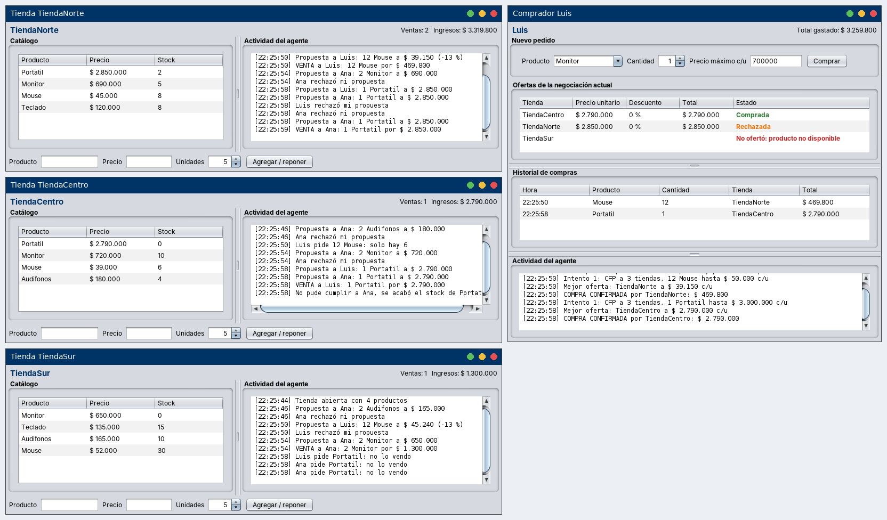
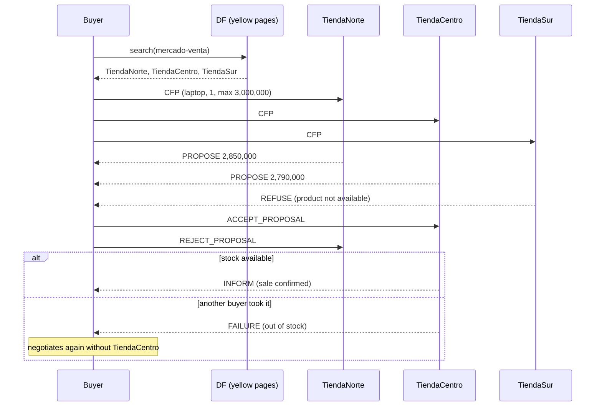
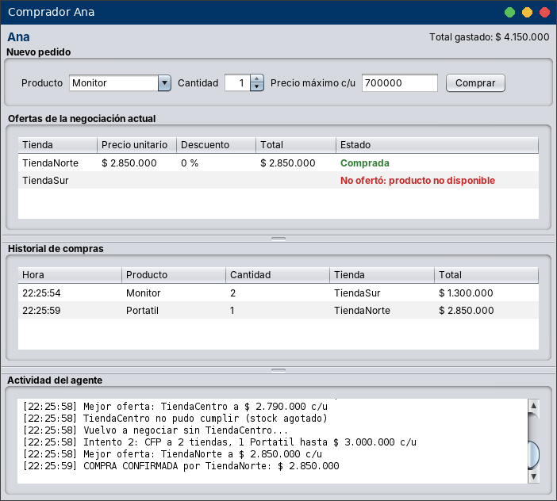
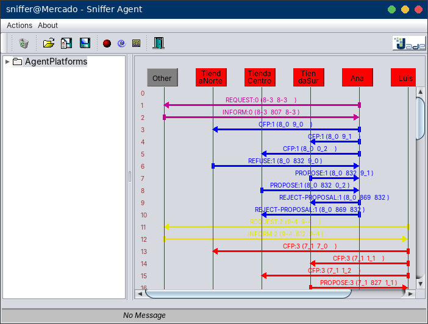

# MercadoAgentes

[](https://github.com/JohnDavidV/MercadoAgentes/actions/workflows/ci.yml)

Multi-agent system in **Java + JADE** where shops and buyers negotiate prices on their own using the **FIPA Contract Net** protocol. Every agent has its own Swing window, so you can watch the negotiation happen in real time.

Built for the *Multi-Agent Systems and Computational Perception* course at UNIR. The user interface is in Spanish.



## How it works

- **Shops** (seller agents) register in the yellow pages (DF) under the `mercado-venta` service. Each one has its own catalog, prices and stock.
- **Buyers** look up every shop in the DF and send a **CFP** (call for proposals) with the product, the quantity and the maximum unit price they are willing to pay.
- Each shop answers with a **PROPOSE**, or with a **REFUSE** when it does not sell the product or does not have enough stock.
- The buyer accepts the cheapest offer under its maximum price and rejects the rest.
- The winning shop confirms the sale (**INFORM**) and updates its stock. If another buyer took the last units between the proposal and the acceptance, it answers **FAILURE** and the buyer **negotiates again automatically** without that shop (up to 3 attempts).

### Highlights

| Feature | Detail |
| --- | --- |
| Protocol | FIPA Contract Net with `ContractNetInitiator` and `SSContractNetResponder` |
| Concurrent negotiations | Each shop serves several buyers at the same time through `SSResponderDispatcher` |
| Service discovery | Yellow pages with `DFService.register` and `DFService.search` |
| Pricing strategy | Volume discount (5 % from 5 units, 10 % from 10) plus 3 % when the shop has plenty of stock |
| Fault tolerance | If the winning shop cannot deliver, the buyer retries without it |
| UI | One Swing window per agent, always updated on the Swing thread |
| Startup | The platform is started from code with `jade.core.Runtime`, no command-line arguments needed |
| Tests | Pricing, stock and message encoding covered with JUnit 5, run on every push |

## Protocol



## Screenshots

**Automatic retry:** Ana and Luis ask for the last laptop at TiendaCentro at the same time. Luis gets it, TiendaCentro answers FAILURE to Ana, and she negotiates again and buys at TiendaNorte.



**JADE Sniffer** showing the negotiation messages (CFP, PROPOSE, REFUSE, REJECT_PROPOSAL...) between buyers and shops:



## Project structure

```
src/mercado
├── Main.java                   starts the platform and creates the agents
├── agentes
│   ├── VendedorAgent.java      shop: DF registration + Contract Net participant
│   └── CompradorAgent.java     buyer: DF search + Contract Net initiator with retries
├── gui
│   ├── VendedorGui.java        catalog, sales and activity log of a shop
│   ├── CompradorGui.java       order form, offers, purchase history and log
│   └── Estilo.java             colors, look and feel, window placement
├── modelo
│   ├── Producto.java
│   ├── Pedido.java             CFP content
│   ├── Oferta.java             PROPOSE and INFORM content
│   └── EstrategiaPrecios.java  discount rules
└── util
    ├── Catalogos.java          sample catalog of each shop
    ├── Contenido.java          key=value encoding of the message content
    └── Formato.java            Colombian pesos and timestamps
test/mercado                    JUnit 5 tests
```

## Running it

Requirements: **JDK 8 or newer**. JADE 4.6.0 is already included in `lib/jade.jar`.

### NetBeans

1. File > Open Project and pick the `MercadoAgentes` folder.
2. Run (F6). The JADE RMA, three shops and two buyers (Ana and Luis) open.
3. In a buyer window choose a product, quantity and maximum price, then press **Comprar**.

### Command line

Windows (PowerShell):

```powershell
mkdir build\classes
javac -encoding UTF-8 -cp lib\jade.jar -d build\classes (Get-ChildItem -Recurse src -Filter *.java).FullName
java -cp "lib\jade.jar;build\classes" mercado.Main
```

Linux / macOS:

```bash
mkdir -p build/classes
javac -encoding UTF-8 -cp lib/jade.jar -d build/classes $(find src -name "*.java")
java -cp lib/jade.jar:build/classes mercado.Main
```

If port 1099 is already used by another JADE platform, pass a different one: `mercado.Main 1100`.

### Things to try

- 2 **Audifonos** with a max price of 100,000: shops make offers, but all of them are above the limit.
- 12 **Mouse** with a max price of 50,000: the volume discount kicks in.
- 1 **Portatil** from Ana and Luis almost at the same time: only TiendaCentro has one at 2,790,000, so one of them gets FAILURE and retries.
- From the RMA open **Tools > Start Sniffer** to see the messages, or add new products from a shop window.

## Tests

The CI workflow compiles the project and runs the JUnit 5 tests in `test/` (pricing strategy, stock updates and message encoding). To run them locally with the JUnit console launcher (`junit-platform-console-standalone-1.10.2.jar` from Maven Central):

```bash
javac -encoding UTF-8 -cp lib/jade.jar -d out/classes $(find src -name "*.java")
javac -encoding UTF-8 -cp lib/jade.jar:out/classes:junit-platform-console-standalone-1.10.2.jar -d out/test $(find test -name "*.java")
java -jar junit-platform-console-standalone-1.10.2.jar execute -cp lib/jade.jar:out/classes:out/test --scan-classpath
```

## Possible improvements

- Use a JADE ontology instead of the key=value message content.
- Multi-round negotiation with counter-offers.
- Persist catalogs and sales in a database.

## Tech

Java 8+, JADE 4.6.0, Swing, JUnit 5, NetBeans (Ant project), GitHub Actions.

## Author

**John David Vásquez Serna** · [GitHub](https://github.com/JohnDavidV) · [LinkedIn](https://www.linkedin.com/in/david-v%C3%A1squez-serna-380867259)

## License

Code released under the MIT license. JADE is distributed by Telecom Italia under the LGPL, see [jade.tilab.com](http://jade.tilab.com).
