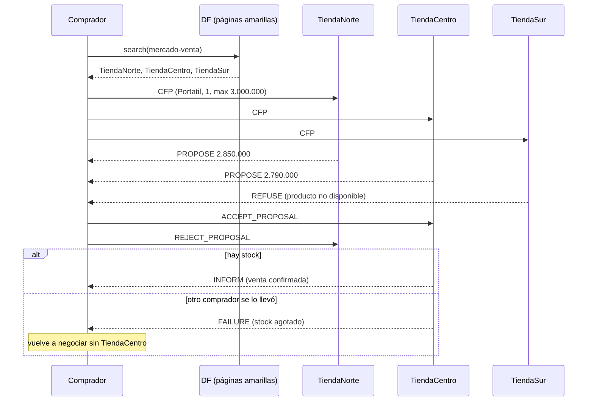

# MercadoAgentes

Sistema multiagente en **Java + JADE** donde varias tiendas y compradores negocian precios de forma autónoma usando el protocolo **FIPA Contract Net**. Cada agente tiene su propia ventana Swing para ver en tiempo real lo que está haciendo.


## ¿Qué hace?

- Las **tiendas** (agentes vendedores) se registran en las páginas amarillas (DF) con el servicio `mercado-venta`. Cada una tiene su propio catálogo, precios y stock.
- Los **compradores** buscan en el DF a todas las tiendas, les envían un **CFP** (call for proposals) con el producto, la cantidad y el precio máximo que están dispuestos a pagar.
- Cada tienda responde con una **propuesta** (PROPOSE) o un **rechazo** (REFUSE) si no tiene el producto o no le alcanza el stock.
- El comprador acepta la oferta más barata que cumpla su precio máximo y rechaza las demás.
- La tienda ganadora confirma la venta (INFORM) y descuenta el inventario. Si entre la propuesta y la aceptación otro comprador se llevó el stock, responde **FAILURE** y el comprador **vuelve a negociar automáticamente** sin esa tienda (hasta 3 intentos).

### Características

| Característica | Detalle |
| --- | --- |
| Protocolo | FIPA Contract Net con `ContractNetInitiator` y `SSContractNetResponder` |
| Negociaciones simultáneas | Cada tienda atiende varios compradores a la vez con `SSResponderDispatcher` |
| Descubrimiento | Páginas amarillas (DF) con `DFService.register` y `DFService.search` |
| Estrategia de precios | Descuento por volumen (5 % desde 5 unidades, 10 % desde 10) y 3 % extra si hay mucho inventario |
| Tolerancia a fallos | Si la tienda ganadora no puede cumplir, se reintenta sin ella |
| Interfaz | Una ventana Swing por agente, actualizada desde el hilo de Swing (`invokeLater`) |
| Arranque | La plataforma se lanza desde código con `jade.core.Runtime`, no hace falta configurar argumentos |

## Protocolo



## Capturas

**Reintento automático:** Ana y Luis piden el último portátil de TiendaCentro al mismo tiempo. Luis se lo lleva, TiendaCentro le responde FAILURE a Ana y ella vuelve a negociar y compra en TiendaNorte.


**Sniffer de JADE** mostrando los mensajes de la negociación (CFP, PROPOSE, REFUSE, REJECT_PROPOSAL...) entre los compradores y las tiendas:


## Estructura

```
src/mercado
├── Main.java                 arranca la plataforma y crea los agentes
├── agentes
│   ├── VendedorAgent.java    tienda: DF + Contract Net (participante)
│   └── CompradorAgent.java   comprador: búsqueda en DF + Contract Net (iniciador)
├── gui
│   ├── VendedorGui.java      catálogo, ventas y log de la tienda
│   ├── CompradorGui.java     pedido, ofertas, historial y log del comprador
│   └── Estilo.java           colores, look and feel y posición de ventanas
├── modelo
│   ├── Producto.java
│   ├── Pedido.java           contenido del CFP
│   └── Oferta.java           contenido del PROPOSE e INFORM
└── util
    ├── Catalogos.java        catálogos de ejemplo de cada tienda
    ├── Contenido.java        formato clave=valor del contenido de los mensajes
    └── Formato.java          pesos colombianos y hora
```

## Cómo ejecutarlo

Requisitos: **JDK 8 o superior**. JADE 4.6.0 ya viene incluido en `lib/jade.jar`.

### Con NetBeans

1. File > Open Project > seleccionar la carpeta `MercadoAgentes`.
2. Run (F6). Se abren el RMA de JADE, las tres tiendas y los compradores Ana y Luis.
3. En la ventana de un comprador elige el producto, la cantidad y el precio máximo, y presiona **Comprar**.

### Desde la consola (Windows)

```powershell
mkdir build\classes
javac -encoding UTF-8 -cp lib\jade.jar -d build\classes (Get-ChildItem -Recurse src -Filter *.java).FullName
java -cp "lib\jade.jar;build\classes" mercado.Main
```

En Linux o macOS se cambia `;` por `:` en el classpath. Si el puerto 1099 está ocupado por otra plataforma JADE se puede pasar otro puerto: `mercado.Main 1100`.

### Ideas para probar

- Pedir 2 **Audifonos** con precio máximo 100.000: las tiendas ofertan, pero todas superan el máximo.
- Pedir 12 **Mouse** con precio máximo 50.000: aplica el descuento por volumen.
- Pedir 1 **Portatil** desde Ana y Luis casi al mismo tiempo: solo TiendaCentro tiene uno a 2.790.000, así que uno de los dos recibe FAILURE y reintenta.
- Desde el RMA abrir **Tools > Start Sniffer** para ver los mensajes, o agregar productos nuevos desde la ventana de una tienda.

## Posibles mejoras

- Usar una ontología de JADE en lugar del formato clave=valor del contenido.
- Negociación en varias rondas (contraofertas) y no solo una propuesta por tienda.
- Guardar el catálogo y las ventas en una base de datos.

## Tecnologías

Java 8+, JADE 4.6.0, Swing, NetBeans (proyecto Ant).

## Autor

**John David Vásquez Serna**. Proyecto hecho mientras cursaba Sistemas Multiagente y Percepción Computacional en UNIR.

[github.com/JohnDavidV](https://github.com/JohnDavidV)

## Licencia

Código bajo licencia MIT. JADE se distribuye bajo licencia LGPL (Telecom Italia), ver [jade.tilab.com](http://jade.tilab.com).
